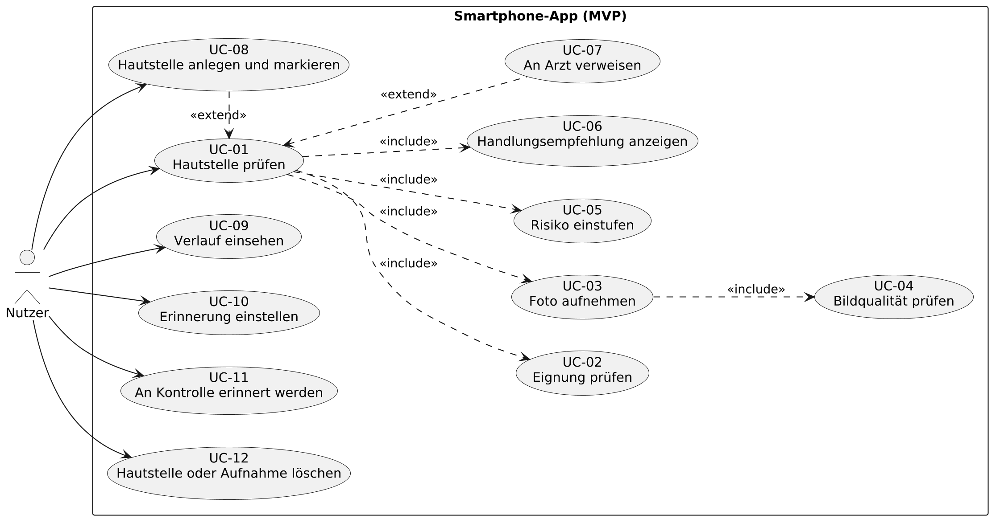

## 1. Projektbeschreibung und Kontext

### 1.1 Einleitung

Im Rahmen unseres Projekts entwickeln wir eine Smartphone-Anwendung zur Objekterkennung. Als Anwendungsfeld haben wir die Hautkrebsvorsorge gewählt, konkret die Erkennung maligner Hautläsionen auf Fotos. [App-Name] wertet Aufnahmen von Hautveränderungen mit KI aus, schätzt das Hautkrebsrisiko in drei Stufen ein und empfiehlt bei Auffälligkeiten den Besuch bei einem Arzt.

Die Marktanalyse hat gezeigt, dass es bereits mehrere Apps zur Erkennung von Hautkrebs gibt (siehe Abschnitt 1.4). Aus dem Vergleich ihrer Funktionen haben wir eine grundlegende Entscheidung abgeleitet: Unsere App stellt keine Diagnose, sondern liefert eine Einschätzung und empfiehlt auf dieser Grundlage gegebenenfalls einen Arztbesuch. Für wen die App gedacht ist und welche Anforderungen sich daraus ergeben, beschreibt Kapitel 3.

### 1.2 Vision

Langfristig soll die App ein digitaler Begleiter für die Hautkrebsvorsorge werden. Nutzer dokumentieren ihre Muttermale regelmäßig, Veränderungen werden automatisch erkannt, und die Ergebnisse lassen sich als Bericht an Hautärzte weitergeben. Über den Kurs hinaus wären eine Anbindung an Teledermatologie-Dienste sowie eine klinische Validierung und Zulassung als Medizinprodukt denkbar.

### 1.3 Nutzungskontext

Die App wird vor allem im Alltag zu Hause genutzt, etwa bei der regelmäßigen Selbstuntersuchung der Haut alle drei Monate. Zusätzlich kann sie in der Freizeit hilfreich sein, zum Beispiel im Sommer oder im Urlaub bei hoher UV-Belastung. Die App richtet sich an Erwachsene jeden Alters, ältere Menschen ausdrücklich eingeschlossen (siehe Kapitel 3). Deshalb legen wir Wert auf eine einfache Bedienung: große Schaltflächen, eine klare Sprache und eine Schritt-für-Schritt-Anleitung bei der Fotoaufnahme.

### 1.4 Ähnliche Apps und Abgrenzung

Zu den bekanntesten Anwendungen gehören SkinVision und SkinScreener, die eine KI-basierte Risikoeinschätzung anbieten, sowie Miiskin, das sich auf die Dokumentation von Muttermalen konzentriert. Teledermatologie-Dienste wie Dermanostic und OnlineDoctor verbinden Nutzer dagegen direkt mit Hautärzten. Unsere App unterscheidet sich vor allem durch die Verbindung von Risikoeinschätzung und Verlaufsbeobachtung in einer einfachen Oberfläche, die auch ältere Nutzer ohne Vorkenntnisse bedienen können. Außerdem bleiben alle Daten auf dem Smartphone: Die KI-Analyse läuft direkt auf dem Gerät, Fotos und Verlauf werden nur lokal gespeichert, und ein Nutzerkonto ist nicht nötig (siehe Kapitel 6).

## 2 Motivation

### 2.1 Ausgangsproblem

Ein Muttermal fällt auf, und plötzlich stellt sich die Frage: Sah das schon immer so aus? Ohne ältere Aufnahmen lässt sich das aus der Erinnerung oft schwer beantworten. Einzelne Fotos in der Smartphone-Galerie helfen nur bedingt, wenn sie zwischen anderen Bildern verschwinden oder später nicht mehr klar ist, welche Körperstelle fotografiert wurde. Genau hier setzt unsere Projektidee an: Hautstellen sollen sich einfach dokumentieren und über einen längeren Zeitraum wiederfinden lassen.

Neben der Dokumentation geht es um den Umgang mit Unsicherheit. Wer eine Hautstelle fotografiert, möchte ein verständliches Ergebnis und wissen, was damit gemeint ist. Die geplante KI-Risikoeinstufung soll deshalb nicht allein stehen, sondern durch eine Erklärung ihrer Grenzen und Hinweise zum weiteren Vorgehen ergänzt werden. Im Studienprojekt untersuchen wir, wie sich dieser Ablauf technisch und in der Benutzeroberfläche umsetzen lässt. Eine verlässliche medizinische Beurteilung können wir mit dem Prototyp nicht anbieten.

### 2.2 Nutzen der App

Unser Ziel ist es, die Beobachtung der eigenen Haut übersichtlicher und im Alltag einfacher zu machen. Dafür verbindet die App mehrere Schritte, die sonst getrennt stattfinden würden:

- **Hautstellen gezielt festhalten:** Eine geführte Kameraaufnahme unterstützt beim Fotografieren. Die Qualitätsprüfung soll ungeeignete Aufnahmen erkennen und zu einer erneuten Aufnahme auffordern.
- **Aufnahmen wiederfinden:** Fotos werden einer Hautstelle zugeordnet und mit ihrem Aufnahmedatum gespeichert. Eine einfache Körperübersicht hilft bei der Orientierung.
- **Einen Verlauf aufbauen:** Frühere Aufnahmen bleiben verfügbar. Nutzer müssen sich dadurch nicht allein auf ihre Erinnerung verlassen. Eine automatische Erkennung von Veränderungen ist damit noch nicht gemeint.
- **Beobachtung nicht vergessen:** Einstellbare Erinnerungen unterstützen dabei, die Dokumentation fortzuführen.

Das Smartphone bietet sich dafür an, weil Kamera, Speicher und Benachrichtigungen bereits vorhanden sind. Zusätzliche Hardware ist für den geplanten Ablauf nicht vorgesehen. Der Verzicht auf ein Nutzerkonto und die zunächst lokale Speicherung sollen den Einstieg erleichtern. Gleichzeitig ist es bei persönlichen Hautfotos wichtig, dass Nutzer nachvollziehen können, wo ihre Bilder gespeichert werden.

### 2.3 Motivation im Studienprojekt

Für das Modul Mobile Software Engineering ist das Thema interessant, weil es mehrere typische Aufgaben mobiler Entwicklung in einem zusammenhängenden Anwendungsfall verbindet: Kamerazugriff, lokale Datenhaltung, Benachrichtigungen und die Einbindung eines KI-Modells auf dem Gerät. Dabei reicht es nicht, dass die einzelnen Funktionen technisch funktionieren. Auch die Bedienung muss verständlich sein, besonders bei Aufnahmefehlern oder einer nicht möglichen Auswertung.

**Der Schwerpunkt liegt auf einem nachvollziehbaren mobilen Prototyp.** Wir wollen zeigen, wie Aufnahme, experimentelle Auswertung und Dokumentation zusammenspielen. Ob die KI medizinisch zuverlässige Ergebnisse liefert, lässt sich daraus nicht ableiten. Die App ersetzt keine ärztliche Untersuchung; auch eine niedrige angezeigte Risikostufe darf nicht als Entwarnung dargestellt werden.

## 3 Zielgruppe

### 3.1 Primäre Zielgruppe

Die geplante App richtet sich an erwachsene Privatpersonen, die einzelne Muttermale oder andere Hautstellen bewusst dokumentieren möchten. Für das MVP konzentrieren wir uns auf deutschsprachige Nutzer mit einem Android-Smartphone. Medizinische Vorkenntnisse sollen für die Bedienung nicht erforderlich sein.

Im Vordergrund stehen zwei Nutzungssituationen:

- **Regelmäßige Dokumentation:** Eine Person möchte bestimmte Hautstellen über längere Zeit festhalten. Wichtig sind für sie eine einfache Zuordnung, eine übersichtliche Bildhistorie und Erinnerungen.
- **Dokumentation aus einem konkreten Anlass:** Einer Person fällt eine Hautstelle auf, die sie bisher nicht bewusst beobachtet hat. Sie möchte eine Aufnahme speichern und benötigt klare Hinweise dazu, was die App leisten kann und wo ihre Grenzen liegen.

Auch ältere Personen gehören ausdrücklich zur Zielgruppe. Die App soll für sie ebenso verständlich und einfach bedienbar sein wie für jüngere Nutzer. Wir legen deshalb keine enge Altersgruppe fest, sondern orientieren uns am Bedürfnis, Hautstellen zu dokumentieren. Für die Bedienung setzen wir lediglich grundlegende Smartphone-Kenntnisse voraus.

### 3.2 Anforderungen aus der Zielgruppe

Aus diesen Nutzungssituationen ergeben sich folgende Anforderungen:

- **Einfache Sprache:** Begriffe wie „Läsion“ müssen erklärt oder in der Oberfläche durch „Hautstelle“ ersetzt werden.
- **Kurzer, geführter Ablauf:** Von der Auswahl einer Hautstelle bis zur gespeicherten Aufnahme sollen möglichst wenige, verständliche Schritte nötig sein.
- **Gut erkennbare Bedienelemente:** Gut lesbare Schrift, deutliche Kontraste und ausreichend große Schaltflächen sollen die Bedienung auch bei eingeschränktem Sehvermögen oder motorischen Schwierigkeiten erleichtern.
- **Lesbare Ergebnisse:** Risikostufen müssen zusätzlich zur Farbe mit Text erläutert werden. Eine Ampelfarbe allein erklärt weder das Ergebnis noch dessen Unsicherheit.
- **Kontrolle über die eigenen Bilder:** Nutzer sollen gespeicherte Aufnahmen leicht wiederfinden und löschen können.
- **Verständliche Grenzen:** Wenn eine Aufnahme nicht ausgewertet werden kann, muss die App den Grund nennen, statt trotzdem ein Ergebnis anzuzeigen.

### 3.3 Abgrenzung

Hautärzte und medizinische Einrichtungen sind keine primäre Zielgruppe des MVP. Es sind weder eine Praxisverwaltung noch eine direkte ärztliche Beratung innerhalb der App vorgesehen. Angehörige können bei schwer erreichbaren Körperstellen beim Fotografieren helfen; eine eigene Rolle oder ein separates Konto ist dafür zunächst nicht geplant.

Für die KI-Auswertung sieht der Architekturentwurf zusätzliche Einschränkungen nach Alter, Hauttyp und Körperstelle vor. Diese sind als technische Grenzen des geplanten Modells zu verstehen. Ob die konkrete Eingrenzung sachlich ausreicht, muss anhand der verwendeten Daten und der Evaluation geprüft werden. Ein Ausschluss bestimmter Gruppen belegt keine Zuverlässigkeit für die übrigen Nutzer.

**Die beschriebene Zielgruppe ist die Zielgruppe des Konzepts.** Der Studienprototyp ist für die Demonstration und Erprobung der Abläufe gedacht, nicht für medizinische Entscheidungen im Alltag.

## 4. Umfang des MVP

### 4.1 Kleinste nützliche Version

Die kleinste nützliche Version der App ermöglicht es, eine Hautstelle zu fotografieren, eine Risikoeinschätzung zu erhalten und daraus eine klare Handlungsempfehlung abzuleiten. Schon damit erfüllt die App ihren Kernzweck: Nutzer erkennen, ob eine Hautveränderung ärztlich abgeklärt werden sollte.

### 4.2 MVP-Funktionalitäten

Aus der Marktanalyse haben wir die folgenden Funktionalitäten für das Minimum Viable Product (MVP) ausgewählt. Die zugehörigen Anwendungsfälle sind in Kapitel 5 beschrieben.

| ID | Bereich | Feature | Beschreibung | Gesehen bei | Use Case |
|---|---|---|---|---|---|
| F1 | Bildaufnahme | Geführte Kameraaufnahme | Overlay für Abstand und Bildausschnitt, manueller Auslöser | SkinVision, SkinScreener, DERM Zero | UC-03 |
| F2 | Bildaufnahme | Bildqualitätsprüfung | Schärfe und Belichtung nach der Aufnahme prüfen und bei Mängeln eine Neuaufnahme verlangen | SkinVision, DermEngine | UC-04 |
| F3 | KI-Analyse | Risikoeinstufung | 3 Stufen (niedrig / mittel / hoch, Ampel) | SkinVision, SkinScreener, Skinive | UC-05 |
| F4 | KI-Analyse | Ausschluss ungeeigneter Fälle | Kinder, Hauttyp V–VI, Schleimhaut, Nägel → direkt zum Arzt | SkinScreener (Hauttyp I–IV), NICE-Auflage bei DERM | UC-02, UC-07 |
| F5 | Ergebnis | Handlungsempfehlung | „In 3 Monaten erneut prüfen“ vs. „Dringend einen Arzt aufsuchen“, immer mit dem Hinweis, dass das Ergebnis nur eine Einschätzung ist, keinen ärztlichen Rat ersetzt und nur ein Arzt eine Diagnose stellen kann | SkinVision, SkinScreener, DERM Zero | UC-06 |
| F6 | Monitoring | Läsionsprofil und Verlauf | Jede Hautstelle mit eigener Bildhistorie, Aufnahmen und Hautstellen lassen sich löschen | SkinVision, Miiskin, MoleScope | UC-08, UC-09, UC-12 |
| F7 | Monitoring | 2D-Bodymap | Läsionen auf einer Körperübersicht markieren und anzeigen | SkinVision, MoleScope, DermEngine | UC-08, UC-09 |
| F8 | Engagement | Erinnerungen | Lokale Benachrichtigung auf dem Gerät, Intervall bis 6 Monate einstellbar oder deaktivierbar | SkinVision, UMSkinCheck, MoleScope | UC-10, UC-11 |

**Geführte Kameraaufnahme (F1):** Die App unterstützt beim Fotografieren, statt nur die Kamera zu öffnen. Ein Overlay im Kamerabild zeigt, wo die Hautstelle liegen und wie groß sie erscheinen soll. So findet der Nutzer den passenden Abstand und Bildausschnitt und löst das Foto anschließend selbst aus. Schärfe und Belichtung prüft die App danach (F2). So entstehen gleichmäßige Aufnahmen, die sich für die KI-Analyse und den späteren Vergleich im Verlauf eignen.

Der Hauptanwendungsfall UC-01 *Hautstelle prüfen* verbindet die Features F1 bis F5 zu einem Ablauf.

### 4.3 Nicht-MVP-Funktionalitäten

Die folgenden Funktionalitäten gehören zur langfristigen Vision und werden im Kurs nur umgesetzt, wenn Zeit bleibt:

| ID | Feature | Beschreibung |
|---|---|---|
| F9 | Arztsuche | Hautarzt in der Nähe über Google Maps finden |
| F10 | UV-Index-Warnung | Warnung bei hohem UV-Index |
| F11 | Symptom-Fragebogen | Symptome wie Juckreiz oder Blutung angeben |
| F12 | Dermatologen-Zweitprüfung | Ergebnis von einem Hautarzt prüfen lassen |
| F13 | PDF-Bericht | Ergebnis als PDF exportieren |
| F14 | Seitenvergleich | Läsionsfotos direkt nebeneinander vergleichen |
| F15 | Risikoprofil und Hauttyp | Risikoprofil und Hauttyp dauerhaft pflegen |
| F16 | Teledermatologie | Fall an einen Facharzt senden |
| F17 | Konto und Einwilligung | Registrieren und Einwilligungen verwalten |

### 4.4 Kriterien für die MVP-Auswahl

Bei der Auswahl der MVP-Funktionen haben wir uns an vier Kriterien orientiert:

1. **Kernnutzen:** Trägt die Funktion direkt dazu bei, verdächtige Hautveränderungen zu erkennen?
2. **Sicherheit:** Verhindert die Funktion Fehleinschätzungen, etwa durch schlechte Bildqualität oder ungeeignete Fälle?
3. **Machbarkeit:** Lässt sich die Funktion mit unserem Wissensstand im Kurszeitraum umsetzen?
4. **Abhängigkeiten:** Bauen andere Funktionen darauf auf?

### 4.5 Machbarkeit im Kurszeitraum

Bis zur Projektabgabe am 05.02.2027 bleiben ab Mitte November knapp 12 Wochen. In diesem Zeitraum ist der MVP-Umfang mit 4 Personen realistisch, wenn wir für die KI-Analyse auf ein vortrainiertes Modell zurückgreifen und es mit einem öffentlichen Datensatz wie HAM10000 oder dem ISIC-Archiv nachtrainieren. Das größte Risiko liegt in der Genauigkeit des Modells bei Fotos, die mit dem Smartphone aufgenommen wurden. Die 2D-Bodymap ist der aufwendigste Teil. Falls die Zeit knapp wird, ersetzen wir sie durch eine einfache Auswahl der Körperregion aus einer Liste.

## 5. Anwendungsfälle und Akteure

Die Anwendungsfälle verfeinern den in Kapitel 4 beschriebenen MVP-Umfang zu konkreten Abläufen. Aus ihnen leiten sich die Komponenten und der Technologiestack in Kapitel 6 ab.

### 5.1 Akteure

Das MVP kennt einen einzigen Akteur: den Nutzer, eine erwachsene Person, die Hautstellen selbst fotografiert, einschätzen lässt und über die Zeit beobachtet. Das KI-Modell läuft auf dem Smartphone und ist damit Teil des Systems (Abschnitt 6.3). Auch die Erinnerungen plant und löst die App selbst aus, ohne externen Dienst. Hautärzte sind nicht beteiligt, da die App den Arztbesuch nur empfiehlt (Abschnitt 3.3).

### 5.2 Use-Case-Diagramm

Abbildung [X] zeigt die zwölf Anwendungsfälle des MVP. Sechs davon startet der Nutzer direkt: Er prüft eine Hautstelle (UC-01), legt eine Hautstelle an (UC-08), sieht ihren Verlauf ein (UC-09), stellt eine Erinnerung ein (UC-10), wird an eine Kontrolle erinnert (UC-11) und löscht Hautstellen oder Aufnahmen (UC-12). Die übrigen Anwendungsfälle sind Teilschritte der Prüfung. Eine include-Beziehung kennzeichnet einen Schritt, der bei jeder Prüfung ausgeführt wird, eine extend-Beziehung einen Schritt, der nur unter einer Bedingung hinzukommt.

### 5.3 Hauptanwendungsfall: Hautstelle prüfen

Der zentrale Anwendungsfall UC-01 führt den Nutzer von der Aufnahme einer Hautstelle zu einer Risikoeinstufung und einem klaren nächsten Schritt. Voraussetzung ist, dass der Nutzer der App den Kamerazugriff erlaubt hat. Der Ablauf gliedert sich in sechs Schritte:

1. Der Nutzer startet die Prüfung für eine neue oder eine bereits angelegte Hautstelle.
2. Die App prüft, ob der Fall für eine Einstufung geeignet ist (UC-02).
3. Der Nutzer fotografiert die Hautstelle (UC-03).
4. Die App stuft das Risiko ein (UC-05).
5. Die App zeigt die Einstufung zusammen mit einer Handlungsempfehlung an (UC-06).
6. Die App speichert das Ergebnis bei der Hautstelle. Eine neue Hautstelle legt der Nutzer dabei auf der Körperübersicht an (UC-08).

Zwei Situationen weichen von diesem Ablauf ab. Ist der Fall ungeeignet, verweist die App an einen Arzt (UC-07) und beendet die Prüfung ohne Einstufung. Schlägt die Analyse fehl, zeigt die App keine Einstufung an und bietet einen neuen Versuch an. Eine Einstufung erscheint also nur nach bestandener Eignungs- und Qualitätsprüfung, und jedes Ergebnis ist anschließend im Verlauf der Hautstelle sichtbar.

### 5.4 Teilschritte der Prüfung

**Eignung prüfen (UC-02).** Bevor ein Foto ausgewertet wird, gibt der Nutzer Alter, Hauttyp und Körperstelle an. Die App sortiert damit Fälle aus, für die eine Einstufung nicht verantwortbar ist: Personen unter 18 Jahren, dunklere Hauttypen sowie Stellen an Schleimhäuten (etwa im Mund) oder an Nägeln. Jeder dieser Gründe führt zum Arztverweis (UC-07), der den konkreten Ausschlussgrund nennt und eine ärztliche Abklärung empfiehlt.

**Foto aufnehmen (UC-03) und Bildqualität prüfen (UC-04).** Ein Overlay in der Kameravorschau führt den Nutzer zu passendem Abstand und Bildausschnitt, die Aufnahme löst er selbst aus. Anschließend prüft die App Schärfe und Belichtung. Unscharfe oder zu dunkle Fotos lehnt sie ab, nennt den Grund und fordert eine neue Aufnahme an. Hat der Nutzer den Kamerazugriff verweigert, erklärt die App, wie er ihn erteilen kann.

**Risiko einstufen (UC-05) und Handlungsempfehlung anzeigen (UC-06).** Das KI-Modell ordnet das Foto einer von drei Stufen zu: niedrig, mittel oder hoch. Jede Stufe hat eine feste Empfehlung. Bei niedrigem Risiko beobachtet der Nutzer die Hautstelle weiter und prüft sie in drei Monaten erneut, bei mittlerem Risiko soll er sie zeitnah und bei hohem Risiko dringend beim Arzt anschauen lassen. Bei jeder Stufe weist die App darauf hin, dass das Ergebnis keine Diagnose ist.

### 5.5 Hautstellen und Verlauf

**Hautstelle anlegen und markieren (UC-08).** Jede beobachtete Hautstelle wird auf einer zweidimensionalen Körperübersicht markiert und kann einen Namen erhalten. Die Körperstelle aus der Eignungsprüfung ist dabei vorausgewählt. Der Anwendungsfall erweitert die Prüfung, wenn das Ergebnis zu einer neuen Hautstelle gehört, und lässt sich auch unabhängig davon nutzen. Steht die Körperübersicht nicht zur Verfügung (siehe Abschnitt 4.5), wählt der Nutzer die Körperregion stattdessen aus einer Liste.

**Verlauf einsehen (UC-09).** Wählt der Nutzer eine Hautstelle auf der Körperübersicht oder, in der Rückfalllösung, aus der Liste der Hautstellen aus, zeigt die App alle Fotos und Einstufungen nach Datum sortiert an. Von hier aus kann er direkt eine Folgeprüfung (UC-01) für diese Hautstelle starten.

**Hautstelle oder Aufnahme löschen (UC-12).** Der Nutzer kann einzelne Aufnahmen oder eine ganze Hautstelle samt Verlauf und Erinnerung löschen. Da gelöschte Fotos nicht wiederhergestellt werden können, fragt die App vorher nach einer Bestätigung. Der Nutzer behält so die Kontrolle über seine Bilder (Abschnitt 3.2).

### 5.6 Erinnerungen

**Erinnerung einstellen (UC-10).** Für jede angelegte Hautstelle wählt der Nutzer ein Kontrollintervall von bis zu sechs Monaten. Er kann das Intervall jederzeit ändern oder die Erinnerung deaktivieren.

**An Kontrolle erinnert werden (UC-11).** Ist der Termin erreicht, zeigt die App eine Benachrichtigung an. Durch Antippen öffnet sich die Folgeprüfung der betreffenden Hautstelle. Hat der Nutzer Benachrichtigungen nicht erlaubt, erscheint die fällige Kontrolle stattdessen in der App.

## 6. Architektur und Technologiestack

Drei Eigenschaften des MVP prägen die Architektur. Die App verarbeitet Hautfotos und damit Gesundheitsdaten im Sinne von Art. 9 DSGVO [1]. Der Hauptanwendungsfall hängt von Kamera und Bildanalyse ab. Und das MVP sieht kein Nutzerkonto vor. Aus der Evaluation in diesem Kapitel ergibt sich daraus eine Grundentscheidung: Die App arbeitet vollständig auf dem Gerät und kommt ohne eigenes Backend aus.

### 6.1 Komponenten

Aus den Anwendungsfällen ergeben sich acht Komponenten. Die Benutzeroberfläche umfasst alle Screens, die Navigation und die Zustandsverwaltung. Die Kameraaufnahme stellt Vorschau, Overlay und Auslöser bereit (UC-03), die Qualitätsprüfung bewertet Schärfe und Belichtung (UC-04). Die Eignungsprüfung gleicht die Angaben des Nutzers mit den Ausschlussregeln ab (UC-02, UC-07). Die KI-Einstufung ordnet ein Foto einer Risikostufe zu und leitet die Empfehlung ab (UC-05, UC-06). Die Datenhaltung speichert und löscht Hautstellen, Ergebnisse und Fotos (UC-01, UC-08, UC-09, UC-12). Über die Körperübersicht markiert und wählt der Nutzer Hautstellen (UC-08, UC-09), und die Erinnerungskomponente plant Termine und löst Benachrichtigungen aus (UC-10, UC-11).

Die App folgt dem Architekturmuster Model-View-ViewModel (MVVM) mit drei Schichten. Die UI-Schicht enthält Screens und ViewModels, die Domänenschicht die Eignungsregeln und die Risikologik, die Datenschicht die Repositories für den Datenzugriff. KI-Modell und Speicher liegen hinter Schnittstellen und bleiben so austauschbar.

### 6.2 Bewertungskriterien

Alle Komponenten werden nach denselben fünf Kriterien bewertet. Beim **Datenschutz** zählt, wie viele Gesundheitsdaten das Gerät verlassen. Die **Offline-Fähigkeit** beschreibt, ob der Anwendungsfall ohne Netzverbindung funktioniert. Der **Aufwand** umfasst Umsetzung und Einarbeitung im Rahmen des Moduls, die **Kosten** laufende Ausgaben für Betrieb und Hosting. Die **Eignung** gibt an, ob eine Lösung den Anwendungsfall vollständig abdeckt. Scheidet eine Option an einem Kriterium eindeutig aus, werden die übrigen nicht weiter betrachtet.

### 6.3 Evaluation und Entscheidung

**Benutzeroberfläche: Kotlin mit Jetpack Compose.** Plattformübergreifende Frameworks wie Flutter oder Kotlin Multiplatform bringen keinen Vorteil, da das MVP nur Android unterstützt (Abschnitt 3.1). Flutter bindet Kamera und KI zudem nur über Plugins an. Gegenüber klassischen XML-Layouts benötigt das deklarative Compose weniger Boilerplate-Code.

**Kameraaufnahme: CameraX.** Die System-Kamera per Intent erlaubt kein Overlay und damit keine geführte Aufnahme. Camera2 verursacht hohen Aufwand und gerätespezifische Fehlerquellen. CameraX stellt Vorschau, Aufnahme und Bildanalyse als fertige Bausteine bereit.

**Qualitätsprüfung: eigene Metriken.** OpenCV vergrößert die App deutlich für wenige genutzte Funktionen, und ein eigenes KI-Modell setzt gelabelte Trainingsdaten voraus. Für das MVP genügt es, nach der Aufnahme die Schärfe über die Varianz des Laplace-gefilterten Bildes und die Belichtung über die mittlere Helligkeit zu messen.

**Eignungsprüfung: Regeln in der Domänenschicht.** Die Ausschlussregeln sind feste Bedingungen, für die weder eine Bibliothek noch ein Dienst nötig ist.

**KI-Einstufung: LiteRT auf dem Gerät.** Die Einstufung kann auf dem Gerät, auf einem eigenen Server oder über einen externen Dienst laufen. Tabelle [X] vergleicht die drei Optionen.

| Kriterium | LiteRT auf dem Gerät | Eigener Server (z. B. FastAPI mit ONNX Runtime) | Externer Dienst |
| --- | --- | --- | --- |
| Datenschutz | Fotos bleiben auf dem Gerät | Fotos gehen an den eigenen Server | Fotos gehen an Dritte |
| Offline-Fähigkeit | ja | nein | nein |
| Aufwand | Modell konvertieren und einbinden | zusätzlich Dienst und Hosting betreiben | gering, aber uns ist kein passender, frei nutzbarer Dienst bekannt |
| Kosten | keine | Hosting | nutzungsabhängig |
| Eignung | nur kompakte Modelle | auch große Modelle | vom Anbieter abhängig |

Ausschlaggebend sind Datenschutz und Offline-Fähigkeit: Die Fotos verlassen das Smartphone nicht, und es entsteht kein Server, der betrieben werden muss. Backend-as-a-Service-Plattformen scheiden für die Inferenz ohnehin aus; Supabase begrenzt seine Edge Functions etwa auf 256 MB Arbeitsspeicher und 2 s CPU-Zeit pro Anfrage [2]. LiteRT ist die Laufzeitumgebung, die Google bis 2024 als TensorFlow Lite entwickelt hat [3]. Ein vortrainiertes, für Mobilgeräte entworfenes Modell wie MobileNet [4] wird auf HAM10000 [5] oder dem ISIC-Archiv nachtrainiert (Abschnitt 4.5). Die drei Risikostufen entstehen über Schwellenwerte auf der Modellausgabe. Zwei Einschränkungen nehmen wir bewusst in Kauf: HAM10000 enthält Nahaufnahmen, die mit einem Spezialgerät beim Hautarzt entstanden sind, keine Smartphone-Fotos [5], und dunkle Hauttypen kommen in öffentlichen Datensätzen kaum vor [6]. Das stützt den Ausschluss dunklerer Hauttypen in der Eignungsprüfung.

**Datenhaltung: Room und privater App-Speicher.** Supabase würde Synchronisation und Gerätewechsel ermöglichen, erfordert dafür aber Login, Zugriffsregeln und die Speicherung von Gesundheitsdaten auf einem Server, und das für Funktionen außerhalb des MVP. Die App speichert daher alles lokal: strukturierte Daten in einer SQLite-Datenbank über die Jetpack-Bibliothek Room, Fotos als Dateien im privaten App-Speicher. Beides wird von der Android-Datensicherung ausgeschlossen, damit keine Gesundheitsdaten ungewollt in die Cloud gelangen.

**Körperübersicht: Compose Canvas.** Eine 3D-Bibliothek geht über den MVP-Umfang hinaus, und eine SVG-Grafik in einer WebView erfordert eine Brücke zwischen Web- und App-Code. Auf dem Canvas lassen sich Vorder- und Rückseite eines Körperumrisses ohne zusätzliche Abhängigkeit zeichnen. Als Rückfallebene dient eine Auswahlliste der Körperregionen (Abschnitt 4.5).

**Erinnerungen: WorkManager.** Push-Nachrichten über Firebase Cloud Messaging setzen einen Server voraus. AlarmManager löst minutengenau aus, benötigt dafür ab Android 12 aber eine widerrufbare Sonderberechtigung, die bei Intervallen von Wochen bis Monaten unnötig ist. WorkManager plant Aufgaben auch nach einem Neustart des Geräts erneut ein.

### 6.4 Gewählter Stack

Tabelle [X] fasst die Entscheidungen zusammen.

| Komponente | Anwendungsfälle | Technologie |
| --- | --- | --- |
| Benutzeroberfläche | alle | Kotlin, Jetpack Compose, MVVM |
| Kameraaufnahme | UC-03 | CameraX |
| Qualitätsprüfung | UC-04 | eigene Metriken |
| Eignungsprüfung | UC-02, UC-07 | Regeln in der Domänenschicht |
| KI-Einstufung | UC-05, UC-06 | LiteRT, nachtrainiertes Modell |
| Datenhaltung | UC-01, UC-08, UC-09, UC-12 | Room, privater App-Speicher |
| Körperübersicht | UC-08, UC-09 | Compose Canvas |
| Erinnerungen | UC-10, UC-11 | WorkManager |

Die optionalen Funktionalitäten F9 und F10 aus Abschnitt 4.3 ändern an dieser Architektur nichts Grundlegendes. Die Arztsuche kann eine installierte Karten-App über einen Intent öffnen, und die UV-Warnung benötigt nur den Abruf eines öffentlichen UV-Index-Dienstes. Ein eigenes Backend ist für keinen der beiden nötig.

## Quellen

Online-Quellen abgerufen am 13.11.2026.

- [1] Verordnung (EU) 2016/679 (Datenschutz-Grundverordnung), Art. 9.
- [2] Supabase: Edge Functions Limits. https://supabase.com/docs/guides/functions/limits; zur Paketgröße: https://supabase.com/docs/guides/troubleshooting/edge-function-fails-deploy
- [3] Google Developers Blog (2024): TensorFlow Lite is now LiteRT. https://developers.googleblog.com/en/tensorflow-lite-is-now-litert/
- [4] Howard, A. G. et al. (2017): MobileNets: Efficient Convolutional Neural Networks for Mobile Vision Applications. arXiv:1704.04861.
- [5] Tschandl, P., Rosendahl, C., Kittler, H. (2018): The HAM10000 dataset, a large collection of multi-source dermatoscopic images of common pigmented skin lesions. Scientific Data 5, 180161. doi:10.1038/sdata.2018.161
- [6] Wen, D. et al. (2022): Characteristics of publicly available skin cancer image datasets: a systematic review. The Lancet Digital Health 4(1), e64–e74. doi:10.1016/S2589-7500(21)00252-1

