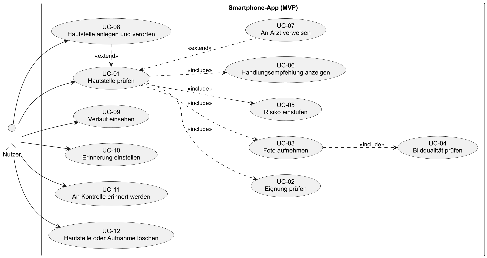

## 5. Anwendungsfälle und Akteure

Die Anwendungsfälle verfeinern den in Kapitel 4 beschriebenen MVP-Umfang zu konkreten Abläufen. Aus ihnen leiten sich die Komponenten und der Technologiestack in Kapitel 6 ab.

### 5.1 Akteure

Das MVP kennt einen einzigen Akteur: den Nutzer, eine erwachsene Person, die Hautstellen selbst fotografiert, einschätzen lässt und über die Zeit beobachtet. Weitere Akteure gibt es nicht. Das KI-Modell läuft auf dem Smartphone und ist damit Teil des Systems (Abschnitt 6.3). Auch die Erinnerungen plant und löst die App selbst aus, ohne externen Dienst. Hautärzte sind nicht beteiligt, da die App den Arztbesuch nur empfiehlt (Abschnitt 3.3).

### 5.2 Use-Case-Diagramm

Abbildung [X] zeigt die zwölf Anwendungsfälle des MVP. Sechs davon startet der Nutzer direkt: Er prüft eine Hautstelle (UC-01), legt eine Hautstelle an (UC-08), sieht ihren Verlauf ein (UC-09), stellt eine Erinnerung ein (UC-10), wird an eine Kontrolle erinnert (UC-11) und löscht Hautstellen oder Aufnahmen (UC-12). Die übrigen Anwendungsfälle sind Teilschritte der Prüfung. Eine include-Beziehung kennzeichnet einen Schritt, der bei jeder Prüfung ausgeführt wird, eine extend-Beziehung einen Schritt, der nur unter einer Bedingung hinzukommt.

### 5.3 Hauptanwendungsfall: Hautstelle prüfen

Der zentrale Anwendungsfall UC-01 führt den Nutzer von der Aufnahme einer Hautstelle zu einer Risikoeinstufung und einem klaren nächsten Schritt. Voraussetzung ist, dass der Nutzer der App den Kamerazugriff erlaubt hat. Der Ablauf gliedert sich in sechs Schritte:

1. Der Nutzer startet die Prüfung für eine neue oder eine bereits angelegte Hautstelle.
2. Die App prüft, ob der Fall für eine Einstufung geeignet ist (UC-02).
3. Der Nutzer fotografiert die Hautstelle (UC-03).
4. Die App stuft das Risiko ein (UC-05).
5. Die App zeigt die Einstufung zusammen mit einer Handlungsempfehlung an (UC-06).
6. Die App speichert das Ergebnis bei der Hautstelle. Eine neue Hautstelle legt der Nutzer dabei auf der Körperübersicht an (UC-08).

Zwei Situationen weichen von diesem Ablauf ab. Ist der Fall ungeeignet, verweist die App an einen Arzt (UC-07) und beendet die Prüfung ohne Einstufung. Schlägt die Analyse fehl, zeigt die App keine Einstufung an und bietet einen neuen Versuch an. Für den gesamten Anwendungsfall gilt damit: Eine Einstufung erscheint nur nach bestandener Eignungs- und Qualitätsprüfung, und jedes Ergebnis ist anschließend im Verlauf der Hautstelle sichtbar.

### 5.4 Teilschritte der Prüfung

**Eignung prüfen (UC-02).** Bevor ein Foto ausgewertet wird, gibt der Nutzer Alter, Hauttyp und Körperstelle an. Die App sortiert damit Fälle aus, für die eine Einstufung nicht verantwortbar ist: Personen unter 18 Jahren, Hauttyp V–VI sowie Hautstellen an Schleimhaut oder Nägeln. Jeder dieser Gründe führt zum Arztverweis (UC-07), der den konkreten Ausschlussgrund nennt und eine ärztliche Abklärung empfiehlt.

**Foto aufnehmen (UC-03) und Bildqualität prüfen (UC-04).** Ein Overlay in der Kameravorschau führt den Nutzer zu passendem Abstand und Bildausschnitt, die Aufnahme löst er selbst aus. Anschließend prüft die App Schärfe und Belichtung. Unscharfe oder zu dunkle Fotos lehnt sie ab, nennt den Grund und fordert eine neue Aufnahme an. Hat der Nutzer den Kamerazugriff verweigert, erklärt die App, wie er ihn erteilen kann.

**Risiko einstufen (UC-05) und Handlungsempfehlung anzeigen (UC-06).** Das KI-Modell ordnet das Foto genau einer von drei Stufen zu: niedrig, mittel oder hoch. Jede Stufe ist mit einer Empfehlung verbunden. Bei niedrigem Risiko soll die Hautstelle weiter beobachtet und in drei Monaten erneut geprüft werden, bei mittlerem Risiko zeitnah und bei hohem Risiko dringend ärztlich abgeklärt werden. Zu jeder Stufe weist die App darauf hin, dass das Ergebnis keine Diagnose ist.

### 5.5 Hautstellen und Verlauf

**Hautstelle anlegen und verorten (UC-08).** Jede beobachtete Hautstelle wird auf einer zweidimensionalen Körperübersicht markiert und kann einen Namen erhalten. Die Körperstelle aus der Eignungsprüfung ist dabei vorausgewählt. Der Anwendungsfall erweitert die Prüfung, wenn das Ergebnis zu einer neuen Hautstelle gehört, und lässt sich auch unabhängig davon nutzen.

**Verlauf einsehen (UC-09).** Wählt der Nutzer eine Hautstelle auf der Körperübersicht aus, zeigt die App alle Fotos und Einstufungen nach Datum sortiert an. Von hier aus kann er direkt eine Folgeprüfung (UC-01) für diese Hautstelle starten.

**Hautstelle oder Aufnahme löschen (UC-12).** Der Nutzer kann einzelne Aufnahmen oder eine ganze Hautstelle samt Verlauf und Erinnerung löschen. Da gelöschte Fotos nicht wiederhergestellt werden können, fragt die App vorher nach einer Bestätigung. So behält der Nutzer die Kontrolle über seine Bilder (Abschnitt 3.2).

### 5.6 Erinnerungen

**Erinnerung einstellen (UC-10).** Für jede angelegte Hautstelle wählt der Nutzer ein Kontrollintervall von bis zu sechs Monaten. Er kann das Intervall jederzeit ändern oder die Erinnerung deaktivieren.

**An Kontrolle erinnert werden (UC-11).** Ist der Termin erreicht, zeigt die App eine Benachrichtigung an. Durch Antippen öffnet sich die Folgeprüfung der betreffenden Hautstelle. Hat der Nutzer Benachrichtigungen nicht erlaubt, erscheint die fällige Kontrolle stattdessen in der App.

